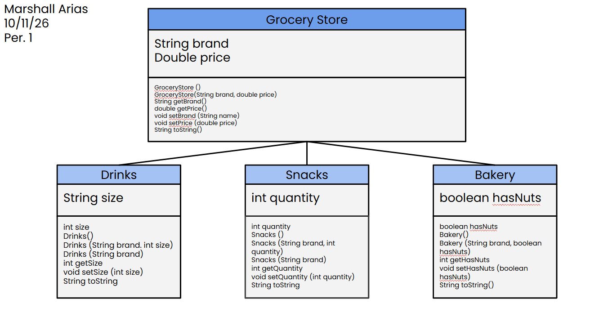

# store-management-project

# Unit 2 - Store Management Project

## Introduction

You are opening a new business in your community! Businesses often need programs to manage the products and services they offer and track orders and requests from customers. Your goal is to create a store management system for your business.

## Requirements

Use your knowledge of object-oriented programming and class structure and design to create your store management system:
- **Create a class hierarchy** – Develop a superclass that represents a product or service your business offers and one or more subclasses that extend the superclass to represent more specific types of products or services.
- **Declare instance variables** – Declare instance variables in the superclass that are shared with the subclasses and instance variables in the subclasses that are not shared with the superclass.
- **Write constructors** – Write no-argument and parameterized constructors in the superclass and subclasses. Subclass constructors use the super keyword to call the superclass constructor.
- **Implement accessor and mutator methods** – Write accessor and mutator methods for instance variables that should be accessible and/or modifiable from outside of the class.
- **Implement a toString() method** – Write toString() methods in the superclass and subclasses that return information about the state of an object.

## UML Diagram

Embed your UML Diagram here. Upload the image of your UML Diagram to your repo, then use Markdown to insert your image here:

## Description

1. The store I made/selected was a Grocery store with a few select objects that I would personally look at when I go to the store. The Grocery store was my superclass and my I had 3 subclasses: Drinks, Snacks, and Bakery. Within my GroceryStore class, I had 2 attributes: String brand and double price, because I believed the two were broad enough to be attached to the superclass. Within my subclasses, each subclass had 1 attribute. Drinks had String size, Snacks had int quantity, and Bakery had boolean hasNuts. I tried to get user input from my family, but they were asleep, so I will just describe what user input is like. The user would be prompted with the beginning question of "What are you looking for today?" and may type 1 for Drinks, 2 for Snacks, and 3 for Bakery; very similar to the simple example. Depending on what the user chooses, they are prompted with an additional question to help specify what they want and what the total price would be based off of their order. The output information would be stored in the console, which influences the price after inputing the toString().

2. This project relates to Technology, Engineering, and Mathematics from the STEAM acronym. Firstly technology because this whole assignment was computers based, and especially because this is a computer science class, which heavily relies on technology. Secondly engineering because we engineered a whole store manager type of code, complete with multiple classes, instance variables, and the this keyword. Lastly, mathenatics to calculate the final price. It may have been a small amount in the grand scheme of the project, but it happened. 

3. The SLOs demonstrated while completing this project were specifically related to time-management and my work. I understand that I definitely managed my time better, but the last few days have been very jam packed, I had to work best with what I could do.

